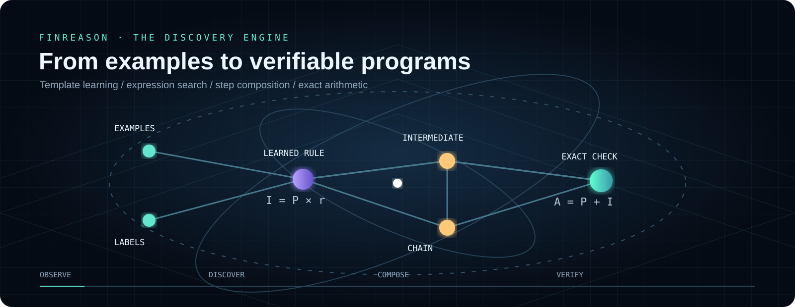
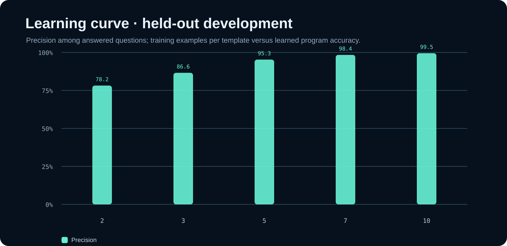
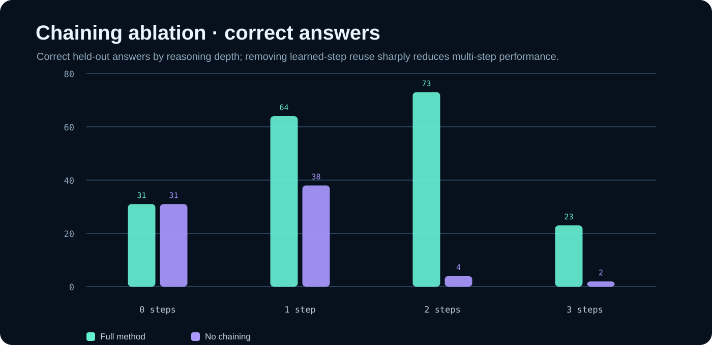
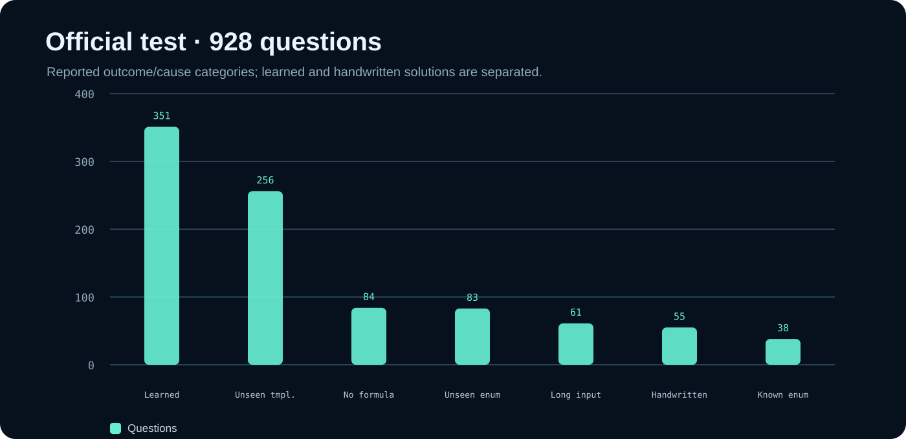

# Learning Verifiable Financial Formulas from Templates

**Hybrid symbolic solving · FinReason Cup 2026 — Task 1**  
**Author:** Umar Tabbsum · **Team:** `ut1776`

  <a href="https://u19725505-star.github.io/finreason-verifiable-financial-formulas/"><strong>ENTER THE INTERACTIVE RESEARCH EXPERIENCE →</strong></a>

  

<em>From examples to expressions. From expressions to composed programs. From programs to exact checks.</em>

> **Explore the live 3D presentation:** [Open FINREASON](https://u19725505-star.github.io/finreason-verifiable-financial-formulas/). The GitHub README uses a lightweight animated SVG and static evidence figures; the website contains the interactive, rotatable 3D research atlas and the step-by-step formula discovery demonstration.

---

## Abstract

Can a system discover the arithmetic programs behind templated financial questions from labeled examples, rather than relying on a hand-written solver for every template?

This project investigates a hybrid symbolic approach. It fingerprints question templates, extracts numeric leaves, searches a bounded arithmetic grammar, reuses learned intermediate steps, and verifies candidate calculations with exact rational arithmetic. When the available evidence does not support a program, the system can abstain.

The central research distinction is between **computational consistency** and **semantic truth**: exact arithmetic can establish that an expression evaluates consistently with observed examples, but it cannot by itself prove that the expression is the intended financial rule for every possible input.

## At a glance

| Evaluation | Reported result |
|---|---:|
| Held-out development questions | 290 |
| Held-out questions answered correctly | **191 / 290** |
| Precision among answered held-out questions | **99.5%** |
| Reasoning slots matched | **332 / 518** |
| Official test questions | 928 |
| Official test questions answered | 406 |
| Official test questions correct | **377 / 928** |
| Official test precision among answered | **92.9%** |
| Combined final-answer score | **0.336389** |
| Hidden-template score | **0.055456** |
| Implied seen-template score | **0.617322** |
| Official rank | **27 / 27** |

**How to read these numbers:** the 99.5% held-out precision is conditional on the questions answered by the learner; it is not 99.5% accuracy over all 290 questions. The official test is a separate evaluation and should not be conflated with held-out development. The official score and rank are reported transparently, including the weak hidden-template result.

## 1 · How the method works

The pipeline is designed to learn reusable arithmetic structure from examples and intermediate trace targets.

1. **Fingerprint the template.** Mask changing numeric values while retaining the question's structural pattern and trace-slot identifiers.
2. **Extract numeric leaves.** Parse the values required by the template and preserve exact numeric representations.
3. **Search candidate programs.** Explore a bounded arithmetic grammar using value signatures and meet-in-the-middle matching to prune candidates.
4. **Learn intermediate steps.** Match candidate expressions against the labeled intermediate values, not only the final answer.
5. **Compose the solution.** Reuse learned intermediate expressions as inputs to later steps and the final-answer program.
6. **Verify and decide.** Evaluate with rational arithmetic, format to the required answer type, and abstain when no sufficiently supported program is found.

## 2 · Interactive formula discovery

The live presentation includes a rotatable 3D formula-discovery lab with four stages:

| Stage | What the demonstration shows |
|---|---|
| Observe | Labeled examples and their numeric inputs |
| Discover | A candidate expression that matches all displayed examples |
| Chain | Reuse of a learned intermediate expression in a final program |
| Verify | Exact fraction arithmetic and comparison of chained and direct evaluations |

**Important:** the lab's simple-interest example is an explicitly illustrative teaching example, not a claim that this particular formula was recovered from the competition benchmark. It demonstrates the mechanics of expression learning, composition, and exact evaluation.

For example, with principal `$P=1,250` and rate `$r=4\\%=1/25`:

$$
I=P\\times r=1,250\\times\\frac{1}{25}=50
$$

$$
A=P+I=1,250+50=1,300
$$

The verification stage also compares the chained expression `P + P × r` with the direct expression `P × (1 + r)` using exact rational values. Agreement establishes arithmetic equivalence for the tested input; it does not establish that the candidate is the correct financial rule in every context.

[**Launch the interactive 3D demonstration →**](https://u19725505-star.github.io/finreason-verifiable-financial-formulas/)

## 3 · Evidence gallery

The following visual summaries are generated from the committed result CSVs. Each links to the corresponding original camera-ready figure where available.

### 3.1 Learning with more labeled examples

As the number of labeled training instances per template increases from 2 to 10, precision among answered held-out questions rises from 78.2% to 99.5%. Coverage and precision are different quantities: the curve describes precision among answered questions, not the percentage of all questions solved.

**Original paper figure:** [Learning curve (PDF)](paper/figures/fig_learning_curve.pdf) · [Underlying CSV](results/tables/learning_curve.csv)

### 3.2 Why chaining matters

The full method correctly answers 191 held-out questions. With chaining disabled, correct answers fall to 75. The largest differences occur on questions requiring two or three reasoning steps, where learned intermediate results can be reused.

| Reasoning depth | Questions | Full method correct | Chaining disabled |
|---:|---:|---:|---:|
| 0 steps | 32 | 31 | 31 |
| 1 step | 69 | 64 | 38 |
| 2 steps | 118 | 73 | 4 |
| 3 steps | 71 | 23 | 2 |
| **Total** | **290** | **191** | **75** |

**Original paper figure:** [Chaining ablation (PDF)](paper/figures/fig_chaining.pdf) · [Underlying CSV](results/tables/chaining_ablation_by_steps.csv)

### 3.3 Official test composition and outcomes

The 928-question official test separates successful answers from several reasons the system did not answer. The learned solver answered 351 questions; the handwritten library answered another 55. Unseen templates and unsupported cases remain a major challenge.

| Outcome / cause | Questions |
|---|---:|
| Solved by learned formula | 351 |
| Unseen template | 256 |
| Known template, no formula found | 84 |
| Unseen template, enumerated answer | 83 |
| Known template, more than 10 numbers or variable count | 61 |
| Solved by handwritten library | 55 |
| Known template, enumerated answer | 38 |
| **Total** | **928** |

**Original paper figure:** [Failure analysis (PDF)](paper/figures/fig_failures.pdf) · [Underlying CSV](results/tables/test_outcome_by_cause.csv)

### 3.4 Held-out performance across domains

Domain-level performance is uneven. Stronger results on some domains coexist with weak performance on others. These percentages are the learned method's held-out development precision by domain; they are not official test scores.

| Domain | Held-out questions | Correct | Precision |
|---|---:|---:|---:|
| Accounting and financial reporting | 20 | 17 | 85.0% |
| Corporate finance | 20 | 11 | 55.0% |
| Crypto finance | 35 | 33 | 94.3% |
| Finance regulation | 25 | 7 | 28.0% |
| Financial markets | 20 | 15 | 75.0% |
| Financial ratios | 20 | 17 | 85.0% |
| Fintech | 15 | 12 | 80.0% |
| Investment analysis | 25 | 8 | 32.0% |
| Mergers and acquisitions | 25 | 16 | 64.0% |
| Personal finance | 25 | 22 | 88.0% |
| Risk management | 35 | 24 | 68.6% |
| Sustainable finance | 25 | 9 | 36.0% |

**Original paper figure:** [Held-out domain results (PDF)](paper/figures/fig_heldout_domain.pdf) · [Underlying CSV](results/tables/dev_heldout_by_domain.csv)

## 4 · Additional camera-ready figures

The repository preserves the original paper figures as PDFs. These are the source figures; the SVG gallery above provides README-friendly visual summaries.

| Figure | What it explains | Original |
|---|---|---|
| Final results | Overall held-out and official evaluation results | [PDF](paper/figures/fig_final_results.pdf) |
| Chaining | Contribution of learned intermediate-step reuse | [PDF](paper/figures/fig_chaining.pdf) |
| Failure taxonomy | Why held-out questions were not solved | [PDF](paper/figures/fig_failures.pdf) |
| Held-out domains | Performance across financial domains | [PDF](paper/figures/fig_heldout_domain.pdf) |
| Learning curve | Precision as labeled examples increase | [PDF](paper/figures/fig_learning_curve.pdf) |
| Improvement potential | Optimistic upper-bound headroom by failure category | [PDF](paper/figures/fig_potential.pdf) |
| Scaling | Program search and complexity behavior | [PDF](paper/figures/fig_scaling.pdf) |
| Test composition | Distribution of answer types in the official test | [PDF](paper/figures/fig_test_composition.pdf) |
| Answer types | Output formats and answer groups | [PDF](paper/figures/fig_answer_types.pdf) |

## 5 · Search and ablation results

The held-out ablations show the trade-off between search capacity, runtime, and the number of correctly recovered programs.

| Configuration | Answered | Correct | Precision among answered | Slots correct | Learning time (s) |
|---|---:|---:|---:|---:|---:|
| Full method (n=10) | 192 | 191 | 99.5% | 332 | 107.1 |
| No pow / max / min | 157 | 156 | 99.4% | 302 | 88.6 |
| No constants | 139 | 138 | 99.3% | 243 | 9.9 |
| Program size ≤ 2 | 133 | 133 | 100.0% | 280 | 4.3 |

The 100% precision in the size-limited setting is conditional on its smaller answered set (133 questions). It should not be interpreted as a better overall solver.

[Full ablation table](results/tables/ablation_heldout_dev.csv)

## 6 · Official test answer types

| Answer group | Questions |
|---|---:|
| USD amounts | 552 |
| Percentages | 154 |
| Enumerated choices / Boolean | 124 |
| Ratios / multiples | 73 |
| Counts / other | 19 |
| Time (days / years) | 6 |
| **Total** | **928** |

[Underlying CSV](results/tables/test_answer_groups.csv) · [Original answer-type figure (PDF)](paper/figures/fig_answer_types.pdf)

## 7 · Limitations and interpretation

- **Seen-template dependence:** a template-level learner requires examples for the relevant template. Unseen-template performance was weak.
- **Coverage versus precision:** high precision among answered questions does not imply broad coverage.
- **Search bounds:** numeric-list length, expression size, operator availability, and enumerated answer formats constrain what can be learned.
- **Exactness is not semantic proof:** rational arithmetic prevents floating-point rounding errors in evaluation, but cannot prove that a candidate expression is the intended general financial rule.
- **Reproducibility status:** the archived scripts reference absolute paths such as `/home/claude/...` and depend on the organizers' `finreason_task1` package and data layout. This repository is a documented research artifact, not yet a turnkey independent reproduction package.
- **Official result:** the final rank was 27 / 27, with a combined final-answer score of 0.336389 and hidden-template score of 0.055456. These limitations are part of the result, not details to hide.

## 8 · Repository guide

| Path | Contents |
|---|---|
| `paper/final/` | Camera-ready paper PDF |
| `paper/source/` | LaTeX source and bibliography |
| `paper/figures/` | Nine original camera-ready PDF figures |
| `results/tables/` | Reviewed CSV result tables |
| `results/predictions/` | Prediction artifact location; currently no prediction records are supplied |
| `docs/METHODOLOGY.md` | Methodology and reproducibility notes |
| `presentation/` | Website assets and README figure previews |
| `index.html`, `styles.css`, `script.js` | Interactive research presentation |

Useful files: [Camera-ready paper](paper/final/camera_ready_final.pdf) · [Methodology](docs/METHODOLOGY.md) · [All result tables](results/tables/) · [All original figures](paper/figures/)

## Explore the project

- **[ENTER THE INTERACTIVE RESEARCH EXPERIENCE](https://u19725505-star.github.io/finreason-verifiable-financial-formulas/)**
- [Source repository](https://github.com/u19725505-star/finreason-verifiable-financial-formulas)
- [Methodology and reproducibility notes](docs/METHODOLOGY.md)
- [Camera-ready paper (PDF)](paper/final/camera_ready_final.pdf)

## Citation

Umar Tabbsum, “Learning Verifiable Financial Formulas from Templates: Hybrid Symbolic Solving for FinReason Cup 2026, Task 1.”

No license has been selected. Reuse rights should not be assumed.
